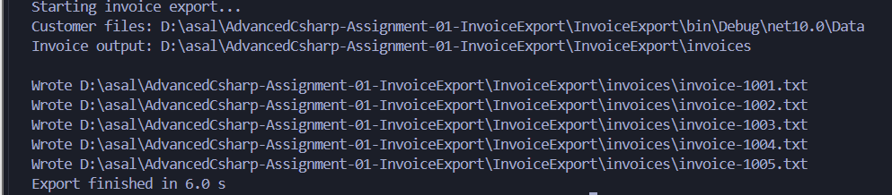
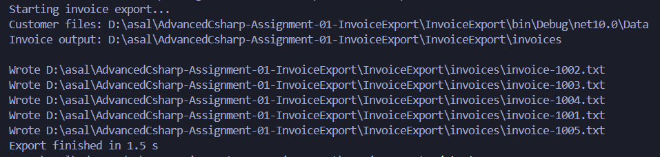

# Assignment 01 — Answers

Student name:  ibrahim ali
Group / ID: 3

## Problems with the current design

1. The application processes orders sequentially instead of concurrently.
2. Thread.Sleep blocks the current thread during simulated delays.
3. File.ReadAllText uses synchronous I/O.
4. File.WriteAllText uses synchronous I/O.
5. GetOrderById performs an unnecessary database query for every order because all pending orders were already loaded.

## What you changed

1. Replaced Thread.Sleep with Task.Delay.
2. Replaced File.ReadAllText with File.ReadAllTextAsync.
3. Replaced File.WriteAllText with File.WriteAllTextAsync.
4. Converted database methods to asynchronous methods.
5. Removed the unnecessary GetOrderById call.
6. Created a separate ExportOrderAsync method for processing each order.
7. Started all order-processing tasks first, then awaited them one by one.

